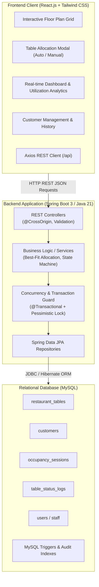
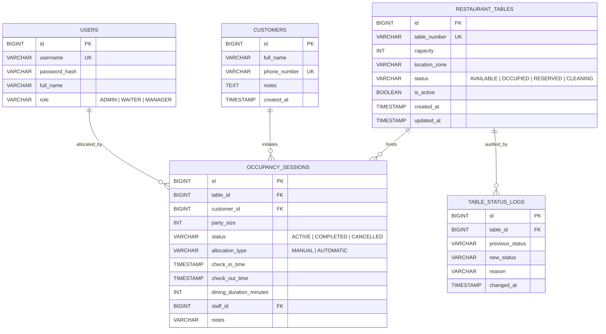

# 🍽️ Restaurant Table Occupancy Management System
> **Course:** Database Management Systems — Project Based Learning (DBMS PBL)  
> **Tech Stack:** React.js, Java Spring Boot 3, MySQL 8.x / 26.x, REST APIs

A full-stack web application designed to simplify and automate restaurant table management, seating allocations, dining durations, and occupancy analytics in real time. Built with strict adherence to database design principles, ACID transactions, and concurrency safeguards to completely prevent double booking conflicts.

---

## 📑 Quick Navigation
- [System Architecture](#-system-architecture)
- [Key Features](#-key-features)
- [Database Design (ER & Schema)](#-database-design-er--schema)
- [ACID & Concurrency Control](#-acid--concurrency-control)
- [Project Structure](#-project-structure)
- [Step-by-Step Setup Guide](#-step-by-step-setup-guide)
- [API Documentation](#-api-documentation)

---

## 🏛️ System Architecture



---

## 🚀 Key Features

1. **Table Management & Floor Plan**:
   - Visual floor plan supporting zones: `MAIN_HALL`, `PATIO`, `BALCONY`, `VIP`.
   - 4-state lifecycle:
     - 🟢 `AVAILABLE` (Ready for seating)
     - 🔴 `OCCUPIED` (Active dining session with live elapsed timer)
     - 🟡 `CLEANING` (Table vacated, awaiting sanitization)
     - 🔵 `RESERVED` (Upcoming reservation)
   - Role-based permissions: Waiter (operations) vs Admin (CRUD operations).

2. **Smart Table Allocation**:
   - **Automatic Best-Fit Algorithm**: Queries MySQL for available tables with capacity $\ge$ party size, selecting the minimum adequate table to prevent wasted seats.
   - **Manual Table Allocation**: Allows staff to pick a specific table for walk-ins or reservations.

3. **Concurrency & Double Allocation Prevention (DBMS Highlight)**:
   - Utilizes MySQL row-level locking (`SELECT ... FOR UPDATE` via JPA `@Lock(LockModeType.PESSIMISTIC_WRITE)`) inside `@Transactional(isolation = Isolation.REPEATABLE_READ)` to guarantee no two concurrent threads can allocate the same table.

4. **Session Tracking & Dining Duration Calculation**:
   - Computes exact customer dining duration in minutes upon checkout.
   - Automatically transitions table to `CLEANING` state upon checkout.
   - One-click "Mark Cleaned" returns the table to `AVAILABLE`.

5. **Occupancy Audit Trail**:
   - MySQL `AFTER UPDATE` trigger (`trg_table_status_audit`) logs every state transition into `table_status_logs` for compliance and analysis.

6. **Dashboard & Utilization Analytics**:
   - Real-time KPIs: Available %, Occupied count, Cleaning count, Active diners, Average dining duration.
   - Per-table turnover count and total occupancy minutes.

---

## 🗄️ Database Design (ER & Schema)

### Entity-Relationship (ER) Diagram



### Relational Schema Summary
- Database scripts are provided in [`database/schema.sql`](database/schema.sql) and [`database/seed.sql`](database/seed.sql).
- Tables created: `users`, `restaurant_tables`, `customers`, `occupancy_sessions`, `table_status_logs`.
- Includes foreign keys (`ON DELETE RESTRICT` / `ON DELETE CASCADE`), unique constraints, and B-Tree indexes for fast status filtering.

---

## 🔒 ACID & Concurrency Control

In high-traffic restaurant operations, two hosts might attempt to seat walk-in parties at the same empty table simultaneously. This system handles concurrency as follows:

1. **Atomicity & Consistency**: All state updates (table status $\rightarrow$ `OCCUPIED`, creation of `OccupancySession`, and status log entry) execute within a single `@Transactional` boundary. If any step fails, the entire transaction rolls back.
2. **Isolation & Pessimistic Locking**:
   ```java
   @Lock(LockModeType.PESSIMISTIC_WRITE)
   @Query("SELECT t FROM RestaurantTable t WHERE t.id = :id")
   Optional<RestaurantTable> findByIdWithLock(@Param("id") Long id);
   ```
   This generates a `SELECT ... FOR UPDATE` query in MySQL, locking the table row until the transaction commits or aborts.
3. **Double Allocation Defense**: The service checks:
   ```java
   if (table.getStatus() != TableStatus.AVAILABLE) {
       throw new TableAlreadyOccupiedException("Table " + table.getTableNumber() + " is already OCCUPIED.");
   }
   ```
   The second incoming request receives an immediate `409 Conflict` response with an explanatory message, protecting database integrity.

---

## 📁 Project Structure

```text
DBMS_PBL/
├── database/
│   ├── schema.sql           # MySQL DDL (Tables, Constraints, Trigger)
│   └── seed.sql             # Sample tables, users, and historical sessions
├── backend/
│   ├── pom.xml              # Maven dependencies (Spring Boot, JPA, MySQL)
│   └── src/
│       ├── main/
│       │   ├── java/com/restaurant/tablemgmt/
│       │   │   ├── RestaurantTableManagementApplication.java
│       │   │   ├── config/       # CORS & DataLoader
│       │   │   ├── controller/   # REST Controllers
│       │   │   ├── dto/          # Request & Response DTOs
│       │   │   ├── entity/       # JPA Entities & Enums
│       │   │   ├── exception/    # Conflict & Exception Handlers
│       │   │   ├── repository/   # Repositories with Locking Queries
│       │   │   └── service/      # Best-Fit & Session Business Logic
│       │   └── resources/
│       │       └── application.properties # MySQL JDBC Connection
│       └── test/java/...         # Concurrency & Best-Fit Tests
├── frontend/
│   ├── package.json         # React 18, Tailwind CSS, Lucide icons, Axios
│   ├── vite.config.js       # Vite configuration with proxy to port 8080
│   ├── tailwind.config.js   # Custom status color palettes
│   └── src/
│       ├── App.jsx          # Root dashboard controller
│       ├── api/tableApi.js  # REST API integration
│       └── components/      # UI Components (FloorPlan, Cards, Modals, Analytics)
├── run-backend.bat          # 1-Click Windows Backend Launcher
├── run-frontend.bat         # 1-Click Windows Frontend Launcher
└── README.md
```

---

## 🛠️ Step-by-Step Setup Guide

### 1. Prerequisites
- **Java**: JDK 17 or JDK 21+ (`java -version`)
- **Node.js**: v18+ and npm (`node -v`, `npm -v`)
- **MySQL Server**: 8.x or 26.x running on port `3306`

### 2. Database Setup (MySQL)
Open MySQL CLI, MySQL Workbench, or phpMyAdmin and execute:
```sql
SOURCE database/schema.sql;
SOURCE database/seed.sql;
```
*(Or the Spring Boot application will automatically initialize the schema and seed data on first boot via Hibernate and `DataLoader.java`!)*

### 3. Backend Setup (Spring Boot)
1. Verify database credentials in [`backend/src/main/resources/application.properties`](backend/src/main/resources/application.properties):
   ```properties
   spring.datasource.url=jdbc:mysql://localhost:3306/restaurant_db?createDatabaseIfNotExist=true&useSSL=false&serverTimezone=UTC
   spring.datasource.username=root
   spring.datasource.password=root
   ```
2. Run the backend:
   ```bash
   cd backend
   mvn spring-boot:run
   ```
   *(Or double-click `run-backend.bat`, or open the `backend` folder in IntelliJ IDEA / VS Code / Eclipse and run `RestaurantTableManagementApplication.java`)*
3. Backend runs at: `http://localhost:8080`

### 4. Frontend Setup (React.js)
1. Install dependencies and start the development server:
   ```bash
   cd frontend
   npm install
   npm run dev
   ```
   *(Or double-click `run-frontend.bat`)*
2. Open your browser and navigate to: `http://localhost:5173`

---

## 📡 REST API Reference

| Method | Endpoint | Description |
| :--- | :--- | :--- |
| `GET` | `/api/tables` | List all tables (with optional `status` and `zone` filters) |
| `POST` | `/api/tables` | Create a new table (Admin) |
| `PUT` | `/api/tables/{id}` | Update table capacity or zone (Admin) |
| `DELETE` | `/api/tables/{id}` | Soft delete table (Admin) |
| `PATCH` | `/api/tables/{id}/status` | Direct status update (e.g. `CLEANING` $\rightarrow$ `AVAILABLE`) |
| `POST` | `/api/allocations/auto` | **Best-Fit Automatic Allocation** based on party size |
| `POST` | `/api/allocations/manual` | **Manual Allocation** for specific table |
| `POST` | `/api/sessions/tables/{tableId}/checkout` | Checkout dining session & mark table `CLEANING` |
| `GET` | `/api/sessions/active` | Get active dining sessions with elapsed duration |
| `GET` | `/api/sessions/logs` | Fetch table status transition audit logs |
| `GET` | `/api/customers` | List all registered customers |
| `POST` | `/api/customers` | Register a new customer |
| `GET` | `/api/analytics/dashboard` | Get real-time KPI metrics for dashboard cards |
| `GET` | `/api/analytics/utilization` | Get per-table utilization and turnover analytics |

---

## 👥 Contributors & Academic Info
- **Project Type:** DBMS Project Based Learning (PBL)
- **Topic:** Restaurant Table Occupancy Management System
